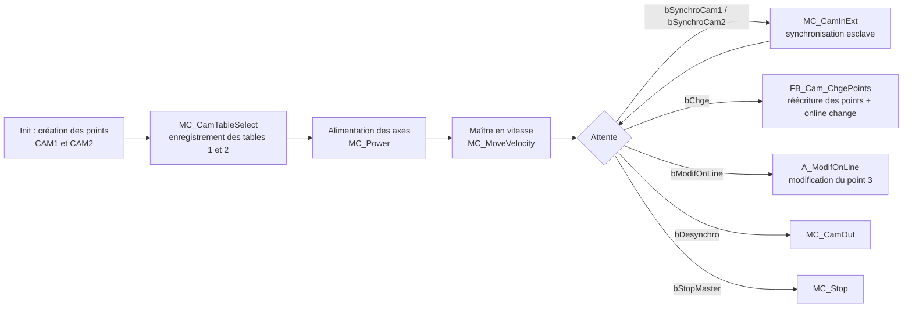
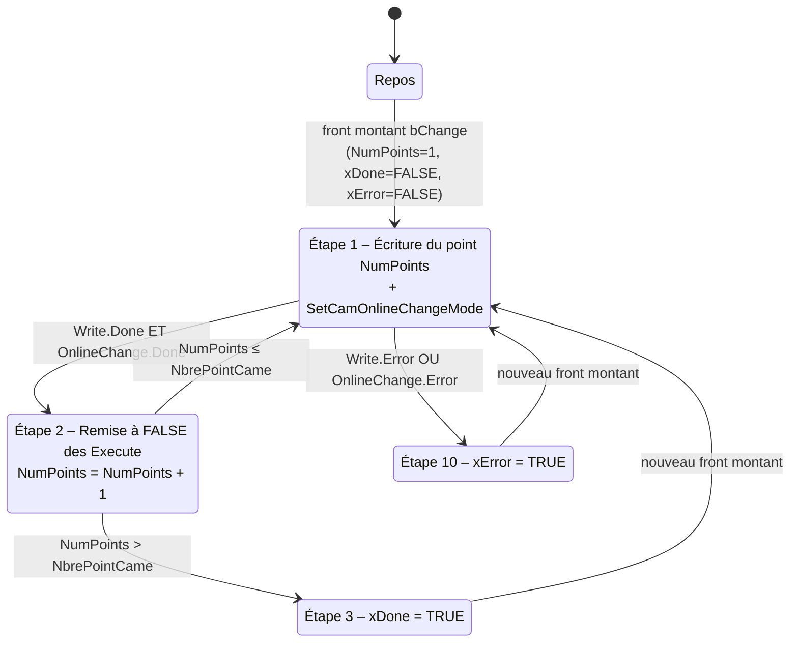
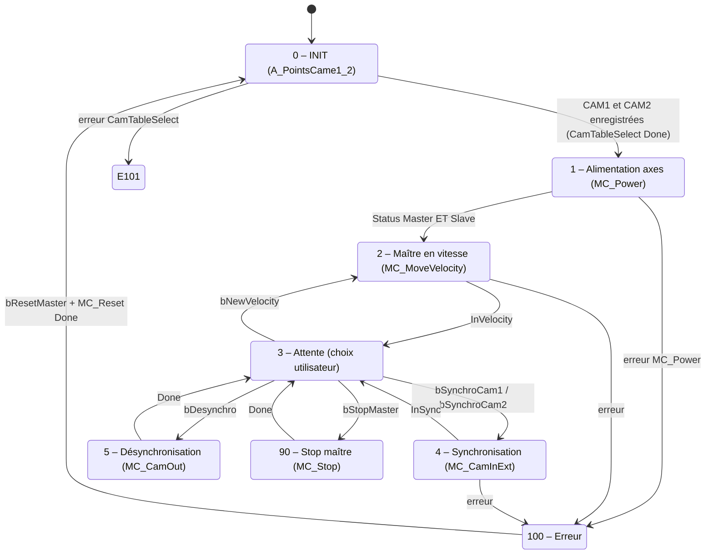

# FB_Cam_ChgePoints – Modification de points de came à chaud

> Projet TwinCAT 3 de démonstration : **synchronisation d'un axe esclave sur un axe maître par came électronique** (bibliothèque `Tc2_MC2`) et **modification des points de la came en cours de fonctionnement** (« online change »).

---

## Sommaire

1. [Présentation](#1-présentation)
2. [Contenu du projet](#2-contenu-du-projet)
3. [Principe de fonctionnement](#3-principe-de-fonctionnement)
4. [Bloc fonctionnel `FB_Cam_ChgePoints`](#4-bloc-fonctionnel-fb_cam_chgepoints)
5. [Bloc fonctionnel `FB_ChangeCamOnFly`](#5-bloc-fonctionnel-fb_changecamonfly)
6. [Bloc fonctionnel `FB_ChangeDynamics`](#6-bloc-fonctionnel-fb_changedynamics)
7. [Programme principal `MAIN`](#7-programme-principal-main)
8. [Mode opératoire utilisateur](#8-mode-opératoire-utilisateur)
9. [Diagnostic et gestion des erreurs](#9-diagnostic-et-gestion-des-erreurs)
10. [Points d'attention](#10-points-dattention)
11. [Mise en œuvre / import du projet](#11-mise-en-œuvre--import-du-projet)

---

## 1. Présentation

Ce projet illustre la mise en œuvre d'une **came électronique** entre deux axes :

- un axe **Maître** (`Master`), entraîné à vitesse constante, dont la position est modulo (cycle de 0 à 360) ;
- un axe **Esclave** (`Slave`), dont la position est calculée en fonction de la position du maître selon une **table de came** (`MC_CAM_REF`) décrite par des **points de mouvement** (`MC_MotionFunctionPoint`).

Il met en évidence trois fonctionnalités :

| Fonctionnalité | Où la trouver |
|---|---|
| Création de deux tables de came (`CAM1`, `CAM2`) et sélection de la came active | `MAIN` – action `A_PointsCame1_2`, étape 4 |
| Changement de came **en cours de synchronisation** (sans désynchroniser l'esclave) | `MAIN` – étape 4 (`MC_CamInExt1`, activation `NEXTCYCLE`) |
| **Modification des points d'une came à chaud**, point par point ou table complète | `FB_Cam_ChgePoints`, `FB_ChangeCamOnFly`, actions `A_ModifOnLine` / `A_ModifOnLine_1` |

Le bloc central, qui donne son nom au projet, est **`FB_Cam_ChgePoints`** : il réécrit automatiquement, point après point, une table de came existante à partir d'un tableau de points, puis demande l'activation de la nouvelle table.

---

## 2. Contenu du projet

Le fichier `FB_Cam_ChgePoints.xml` est un export **PLCopen XML** du projet `PLCCam` (généré avec TwinCAT PLC Control 3.5.21.61).

| Élément | Type | Rôle | Compilé |
|---|---|---|---|
| `FB_Cam_ChgePoints` | Function Block | Réécrit les points d'une came (boucle sur `1…NbrePointCame`) puis active la modification en ligne | Oui |
| `FB_ChangeCamOnFly` | Function Block | Réécrit **toute** la table (`MC_CAM_REF`) en un appel puis active la modification en ligne | Oui (non instancié dans `MAIN`) |
| `FB_ChangeDynamics` | Function Block | Enchaîne 5 `MC_MoveAbsolute` en blending pour changer la dynamique d'un axe | **Non** (`ExcludeFromBuild`) |
| `MAIN` | Programme | Machine à états principale : alimentation, mise en vitesse, synchronisation, désynchronisation, arrêt, reset | Oui |
| `A_Couplage` | Action de `MAIN` | Appel d'un `MC_GearIn` (couplage en rapport de vitesse) – **non appelée** | – |
| `A_ModifOnLine` | Action de `MAIN` | Modifie le point 3 de la CAM 1 à chaud (activation à la position du maître) | Oui |
| `A_ModifOnLine_1` | Action de `MAIN` | Variante de modification du point 3 – **appel commenté** | – |
| `A_Modulo` | Action de `MAIN` | Applique un nouveau modulo à l'axe maître (`FB_Modulo`) | Oui |
| `A_PointsCame1_2` | Action de `MAIN` | Définit les points de CAM 1 et CAM 2 et les enregistre (`MC_CamTableSelect`) | Oui |
| `A_Power` | Action de `MAIN` | Alimentation des axes (`MC_Power`) et lecture d'état de came (`MC_CamInfo`) | Oui |
| `A_ReadMotion` | Action de `MAIN` | Lecture de la table de came (nombre de points, point, position/vitesse esclave, position maître) | Oui |

> **Constante `NbrePointCame`** : elle n'est pas déclarée dans cet export (variable globale / GVL). Elle doit être définie dans le projet. Dans ce programme, elle correspond à **5** points (`NoOfRows := 5`).

---

## 3. Principe de fonctionnement



**Notions clés utilisées**

- **Point de came** (`MC_MotionFunctionPoint`) : position maître (`MasterPos`), position esclave (`SlavePos`), type de point (`PointType`), type de fonction d'interpolation vers le point suivant (`FunctionType`), vitesse esclave éventuelle (`SlaveVelo`).
- **Table de came** (`MC_CAM_REF`) : pointeur sur le tableau de points, taille, type de table (`MC_TABLETYPE_MOTIONFUNCTION`), nombre de lignes/colonnes.
- **Identifiant de table** (`CamTableID`) : numéro sous lequel la table est enregistrée dans le NC (ici 1 et 2).
- **Online change** (`MC_SetCamOnlineChangeMode`) : demande au NC d'appliquer la table modifiée sur la synchronisation en cours, selon un mode d'activation (instantané, au prochain cycle, …).

---

## 4. Bloc fonctionnel `FB_Cam_ChgePoints`

### 4.1 Rôle

À chaque **front montant** de `bChange`, le bloc :

1. parcourt les points `1` à `NbrePointCame` du tableau `PointsChge` ;
2. écrit chaque point dans la table de came `NumCAM_Index` (`MC_WriteMotionFunctionPoint`) ;
3. demande l'activation de la modification en ligne (`MC_SetCamOnlineChangeMode`) pour chaque point écrit ;
4. signale la fin (`xDone`) ou une erreur (`xError`).

### 4.2 Interface

| Catégorie | Nom | Type | Description |
|---|---|---|---|
| `VAR_INPUT` | `bChange` | `BOOL` | Lance la procédure sur **front montant** |
| `VAR_INPUT` | `NumCAM_Index` | `UDINT` | `CamTableID` de la table à modifier (ex. 1 ou 2) |
| `VAR_OUTPUT` | `xDone` | `BOOL` | `TRUE` lorsque tous les points ont été écrits |
| `VAR_OUTPUT` | `xError` | `BOOL` | `TRUE` si une écriture ou un changement en ligne est en erreur |
| `VAR_IN_OUT` | `PointsChge` | `ARRAY [*] OF MC_MotionFunctionPoint` | Tableau de points (longueur variable) contenant les nouvelles valeurs |

Variables internes :

| Nom | Type | Rôle |
|---|---|---|
| `EtapeChge` | `INT` | Numéro d'étape de la machine à états |
| `R_TRIGCge` | `R_TRIG` | Détection du front montant de `bChange` |
| `NumPoints` | `UDINT` | Index du point en cours d'écriture |
| `eActivationMode` | `MC_CamActivationMode` | Mode d'activation, initialisé à `MC_CAMACTIVATION_NEXTCYCLE` |
| `MC_WriteMotionFunction` | `MC_WriteMotionFunctionPoint` | Écriture d'un point dans la table |
| `FB_SetCamOnlineChangeMode` | `MC_SetCamOnlineChangeMode` | Activation de la modification en ligne |

### 4.3 Machine à états



| Étape | Action | Condition de sortie |
|---|---|---|
| **Repos** (`EtapeChge = 0`) | Aucune action | Front montant sur `bChange` |
| **Front montant** | `EtapeChge := 1`, `xDone := FALSE`, `xError := FALSE`, `NumPoints := 1` ; les deux FB passent à `Execute := FALSE` pour armer un nouveau front | – |
| **1** | `MC_WriteMotionFunctionPoint(Execute:=TRUE, CamTableID:=NumCAM_Index, PointID:=NumPoints, Point:=PointsChge[NumPoints])` **et** `MC_SetCamOnlineChangeMode(Execute:=TRUE, ActivationMode:=eActivationMode, ActivationPosition:=0, MasterScalingMode:=1, SlaveScalingMode:=1, CamTableID:=NumCAM_Index)` | `Done` des deux FB → étape 2 ; `Error` de l'un des deux → étape 10 |
| **2** | `Execute := FALSE` sur les deux FB, puis `NumPoints := NumPoints + 1` | `NumPoints ≤ NbrePointCame` → étape 1 ; sinon étape 3 |
| **3** | `xDone := TRUE` | Prochain front montant de `bChange` |
| **10** | `xError := TRUE` | Prochain front montant de `bChange` |

### 4.4 Exemple d'appel (extrait de `MAIN`)

```iecst
FB_Cam_ChgePoints1(
    bChange      := bChge,
    NumCAM_Index := CamIndex,
    xError       => bErrorChge,
    xDone        => ,
    PointsChge   := PointsCam1 );
```

> `NumCAM_Index` désigne la table **cible** dans le NC, et `PointsChge` le tableau **source**. Les deux doivent être cohérents (voir [§10](#10-points-dattention)).

---

## 5. Bloc fonctionnel `FB_ChangeCamOnFly`

Variante qui réécrit **toute la table** en un seul appel `MC_WriteMotionFunction` à partir d'un `MC_CAM_REF`, puis active la modification en ligne.

| Catégorie | Nom | Type | Description |
|---|---|---|---|
| `VAR_INPUT` | `xExecute` | `BOOL` | Démarrage (maintenir `TRUE` jusqu'à `xDone` ou `xError`) |
| `VAR_INPUT` | `CAM` | `MC_CAM_REF` | Table de came contenant les nouveaux points |
| `VAR_INPUT` | `CamTableID` | `MC_CAM_ID` | Identifiant de la table à modifier |
| `VAR_INPUT` | `ActivationMode` | `MC_CamActivationMode` | Défaut : `MC_CAMACTIVATION_NEXTCYCLE` |
| `VAR_OUTPUT` | `xActive` | `BOOL` | Séquence en cours |
| `VAR_OUTPUT` | `xDone` | `BOOL` | Séquence terminée sans erreur |
| `VAR_OUTPUT` | `xError` | `BOOL` | Erreur dans l'une des deux commandes |

| Étape `iStep` | Action | Transition |
|---|---|---|
| **0** | Repos (`Execute` des FB à `FALSE`) | `xExecute` → `xActive := TRUE`, `xDone := FALSE`, étape 1 |
| **1** | `MC_WriteMotionFunction` : écriture de `CAM.NoOfRows` points à partir du point 1 | `Done` → étape 2 ; `Error` → étape 99 |
| **2** | `MC_SetCamOnlineChangeMode` | `Done` → étape 3 ; `Error` → étape 99 |
| **3** | `xDone := TRUE` | Retour à 0 quand `xExecute` retombe |
| **99** | Erreur | Retour à 0 quand `xExecute` retombe |

---

## 6. Bloc fonctionnel `FB_ChangeDynamics`

> Ce bloc est **exclu de la compilation** (`ExcludeFromBuild`). Il est conservé comme exemple.

Il enchaîne **5 déplacements absolus** (`MC_MoveAbsolute`) sur un axe `Axe`, en mode *blending*, pour modifier la vitesse au fil du déplacement.

| Catégorie | Nom | Type | Description |
|---|---|---|---|
| `VAR_INPUT` | `bChangeSpeed` | `BOOL` | Démarrage sur front montant |
| `VAR_INPUT` | `lrPos` | `ARRAY[1..5] OF LREAL` | Positions cibles de chaque segment |
| `VAR_INPUT` | `lrNewSpeed` | `ARRAY[1..5] OF LREAL` | Vitesse de chaque segment |
| `VAR_OUTPUT` | `bEnd` | `BOOL` | Séquence terminée |
| `VAR_IN_OUT` | `Axe` | `Axis_Ref` | Axe commandé |

Le premier mouvement utilise `MC_Aborting` (il interrompt le mouvement en cours), les suivants `MC_BlendingNext`. À la fin du 5ᵉ déplacement, `bEnd` passe à `TRUE` et les commandes sont réinitialisées.

---

## 7. Programme principal `MAIN`

### 7.1 Variables de commande (à piloter depuis TwinCAT en ligne ou une IHM)

| Variable | Type | Fonction |
|---|---|---|
| `bStartAxis` | `BOOL` | Demande d'alimentation des deux axes |
| `VitesseMaster` | `LREAL` | Vitesse de l'axe maître (initialisée à **100**) |
| `bNewVelocity` | `BOOL` | Applique une nouvelle vitesse au maître |
| `bSynchroCam1` | `BOOL` | Synchronise l'esclave sur la **CAM 1** |
| `bSynchroCam2` | `BOOL` | Synchronise l'esclave sur la **CAM 2** |
| `bModifOnLine` | `BOOL` | Modifie le point 3 de la CAM 1 à chaud (`A_ModifOnLine`) |
| `bChge` | `BOOL` | Lance `FB_Cam_ChgePoints1` (front montant) |
| `CamIndex` | `UDINT` | Table cible de `FB_Cam_ChgePoints1` |
| `bDesynchro` | `BOOL` | Désynchronise l'esclave (`MC_CamOut`) |
| `bStopMaster` | `BOOL` | Arrête l'axe maître (`MC_Stop`) |
| `bResetMaster` | `BOOL` | Acquittement de défaut (`MC_Reset`) |
| `bNewModulo` / `newModulo` | `BOOL` / `LREAL` | Applique un nouveau modulo au maître |
| `bReadMotionFunction`, `bReadMotionFunctionPoint`, `bReadCamTableSlaveDynamics`, `bReadCamTableMasterPosition` | `BOOL` | Déclenchent les lectures de la table (`A_ReadMotion`) |
| `bGearIn` | `BOOL` | Commande de `MC_GearIn` (`A_Couplage`, non appelée) |

### 7.2 Variables d'état

| Variable | Description |
|---|---|
| `Etape` (`SINT`) | Étape de la machine à états principale |
| `SyncCamOk` | `TRUE` lorsque l'esclave est synchronisé sur une came |
| `CamTableID` | Came sélectionnée pour la synchronisation (1 ou 2) |
| `bPowerMaster` / `bPowerSlave` | Autorisations `MC_Power` |
| `bErrorChge` | Erreur remontée par `FB_Cam_ChgePoints1` |
| `vNumPointsRead`, `vPoint`, `fSlavePosition`, `fSlaveVelocity`, `pMasterLow`, `pMasterHigh` | Résultats des lectures de `A_ReadMotion` |

Entrée physique : `BpMarche` est liée à `Term 3 (EL1008)`, voie 4 (`TIID^Device 1 (EtherCAT)^Term 1 (EK1100)^…`). Elle est déclarée mais **non utilisée** dans le code exporté.

### 7.3 Machine à états



| Étape | Fonction | Détails |
|---|---|---|
| **0** | Initialisation | Exécute `A_PointsCame1_2` à chaque cycle jusqu'à ce que les deux `MC_CamTableSelect` soient `Done` |
| **1** | Alimentation | `bStartAxis` → `bPowerMaster` et `bPowerSlave` à `TRUE`. Passage à l'étape 2 quand les deux axes sont alimentés |
| **2** | Mise en vitesse du maître | `MC_MoveVelocity` à `VitesseMaster`, sens positif |
| **3** | Attente | Choix de la came, désynchronisation, changement de vitesse, arrêt, modification à chaud (`bModifOnLine` si `CamTableID = 1`) |
| **4** | Synchronisation | `MC_CamInExt` sur la table `CamTableID`. 1ʳᵉ synchro : activation **instantanée** ; synchro déjà active : activation **au prochain cycle** (changement de came sans désynchroniser) |
| **5** | Désynchronisation | `MC_CamOut` ; `SyncCamOk := FALSE` à la fin |
| **90** | Arrêt du maître | `MC_Stop` |
| **100** | Erreur | `SyncCamOk := FALSE`, attente de `bResetMaster` pour `MC_Reset`, puis retour à l'étape 0 |
| **101** | Erreur d'enregistrement des tables | Étape de défaut posée par `A_PointsCame1_2` (aucune sortie prévue dans le `CASE`) |

Paramètres de `MC_CamInExt1` : positions et échelles maître/esclave à `0` / `1.0`, `StartMode = MC_STARTMODE_MASTERREL_SLAVEABS`, interpolation linéaire, `ActivationPosition = 0`.

À chaque cycle, `MAIN` exécute également : `A_Modulo`, `A_Power`, `A_ReadMotion`, l'inversion de `bReadInfoCam` (lecture d'état de came **tous les 2 cycles**) et l'appel de `FB_Cam_ChgePoints1`.

### 7.4 Tables de came

Les deux tables sont **périodiques**, avec maître et esclave en positions **absolues** (`Periodic`, `MasterAbsolute`, `SlaveAbsolute` à `TRUE`). Chacune compte 5 points.

**CAM 1** (`CamTableID = 1`, tableau `PointsCam1`)

| Point | Maître | Esclave | Type de point | Fonction (vers le point suivant) | Remarque |
|---|---|---|---|---|---|
| 1 | 0 | 0 | `REST` | `POLYNOM5_MM` | Polynôme 5 (mode automatique) |
| 2 | 90 | 100 | `VELOCITY` | `POLYNOM5_MM` | `SlaveVelo = 0.8` |
| 3 | 150 | 130 | `REST` | `POLYNOM5_MM` | Point modifié par `A_ModifOnLine` |
| 4 | 300 | 130 | `REST` | `POLYNOM5_MM` | – |
| 5 | 360 | 0 | `REST` | `POLYNOM3` | Fermeture du cycle |

**CAM 2** (`CamTableID = 2`, tableau `PointsCam2`)

| Point | Maître | Esclave | Type de point | Fonction |
|---|---|---|---|---|
| 1 | 0 | 0 | `REST` | `POLYNOM3` |
| 2 | 100 | 150 | `REST` | `POLYNOM3` |
| 3 | 106 | 150 | `REST` | `POLYNOM3` |
| 4 | 236 | 0 | `REST` | `POLYNOM3` |
| 5 | 360 | 0 | `REST` | `POLYNOM3` |

### 7.5 Modifications à chaud dans `MAIN`

| Action | Point modifié | Nouvelles valeurs | Activation |
|---|---|---|---|
| `A_ModifOnLine` (appelée via `bModifOnLine`) | Point 3 de la CAM 1 | `POLYNOM3`, `REST`, Maître = **150**, Esclave = **160** | `eActivationMode` (initialisé à `INSTANTANEOUS`), position d'activation = `Master.NcToPlc.ModuloSetPos` |
| `A_ModifOnLine_1` (appel commenté) | Point 3 de la CAM 1 | `POLYNOM3`, `REST`, Maître = **300**, Esclave = **100** | idem |

---

## 8. Mode opératoire utilisateur

### 8.1 Prérequis

- Projet NC configuré avec **deux axes** liés aux variables `Master` et `Slave` (`AXIS_REF`), en liaison avec leurs variateurs (EtherCAT ou axes virtuels pour test).
- Bibliothèque **`Tc2_MC2`** (et `Tc2_MC2_Drive` pour `MC_Power` selon la configuration) référencée dans le projet PLC.
- Constante **`NbrePointCame`** définie dans le projet (valeur : 5).
- Projet activé, chargé et PLC en **RUN**. Les variables de commande sont modifiées en ligne (*Écrire valeur* ou *Forcer*), ou depuis une IHM.

> Dans TwinCAT, pour les variables `BOOL` de commande : **Écrire la valeur TRUE**. Les commandes `bStartAxis`, `bSynchroCam1/2`, `bModifOnLine`, `bDesynchro`, `bNewVelocity`, `bStopMaster` sont remises à `FALSE` automatiquement par le programme. **`bChge`, `bNewModulo`, les `bRead…` et `bGearIn` restent à `TRUE` tant que l'utilisateur ne les remet pas à `FALSE`.**

### 8.2 Démarrage

| N° | Action de l'utilisateur | Résultat attendu |
|---|---|---|
| 1 | Passer le PLC en **RUN**. | `Etape` passe de 0 à 1 une fois les tables CAM 1 et CAM 2 enregistrées. Si `Etape = 101`, voir [§9](#9-diagnostic-et-gestion-des-erreurs). |
| 2 | Vérifier que `Etape = 1`. | Le programme attend la demande d'alimentation. |
| 3 | Mettre **`bStartAxis := TRUE`**. | Les axes `Master` et `Slave` sont alimentés (`MC_PowerMaster.Status` et `MC_PowerSlave.Status`). |
| 4 | Régler **`VitesseMaster`** (défaut : 100). | – |
| 5 | Attendre le passage à `Etape = 3`. | Le maître tourne à la vitesse demandée ; le programme est en **attente de commande**. |

### 8.3 Synchroniser l'esclave sur une came

| N° | Action | Résultat |
|---|---|---|
| 1 | Mettre **`bSynchroCam1 := TRUE`** (came 1) **ou** **`bSynchroCam2 := TRUE`** (came 2). | `CamTableID` prend la valeur 1 ou 2 ; `Etape` passe à 4. |
| 2 | Attendre `SyncCamOk = TRUE`. | L'esclave suit la came ; retour à `Etape = 3`. |

Pour **changer de came** pendant la synchronisation, activer simplement l'autre commande (`bSynchroCam1` ou `bSynchroCam2`) : le changement est pris en compte **au prochain cycle** sans désynchroniser l'esclave.

### 8.4 Modifier les points d'une came à chaud

#### Méthode A – Écriture complète avec `FB_Cam_ChgePoints1` (recommandée)

| N° | Action | Résultat |
|---|---|---|
| 1 | Dans le tableau **`PointsCam1`** (watch/IHM), saisir les nouvelles valeurs de chaque point : `MasterPos`, `SlavePos`, `FunctionType`, `PointType`, etc. | Nouvelles valeurs prêtes en mémoire (rien n'est encore envoyé au NC). |
| 2 | Renseigner **`CamIndex`** avec le numéro de table cible (ex. **1**). | – |
| 3 | Mettre **`bChge := FALSE`** puis **`TRUE`** (front montant). | `FB_Cam_ChgePoints1` écrit les points 1 à 5, un par un, avec activation en ligne. |
| 4 | Surveiller **`FB_Cam_ChgePoints1.xDone`** et **`bErrorChge`**. | `xDone = TRUE` : modification terminée. `bErrorChge = TRUE` : voir [§9](#9-diagnostic-et-gestion-des-erreurs). |
| 5 | Remettre **`bChge := FALSE`** avant une nouvelle modification. | Prêt pour un nouveau front montant. |

> ⚠️ `xDone` n'est pas câblé vers une variable dans `MAIN` : il se lit directement dans l'instance `FB_Cam_ChgePoints1`.
>
> ⚠️ Dans `MAIN`, le tableau transmis est **toujours `PointsCam1`**. Voir [§10](#10-points-dattention) avant d'utiliser `CamIndex = 2`.

#### Méthode B – Modification d'un seul point (`A_ModifOnLine`)

| N° | Action | Résultat |
|---|---|---|
| 1 | S'assurer que le programme est à `Etape = 3` et que `CamTableID = 1` (synchronisation sur la CAM 1 ou dernière came choisie). | – |
| 2 | Mettre **`bModifOnLine := TRUE`**. | Le point 3 de la CAM 1 est réécrit (Maître = 150, Esclave = 160) et la modification est activée selon `eActivationMode`. `bModifOnLine` est remis à `FALSE` automatiquement. |

Pour modifier un autre point ou d'autres valeurs, adapter l'action `A_ModifOnLine` (ou activer l'appel commenté `A_ModifOnLine_1()` à l'étape 3).

### 8.5 Autres commandes

| Besoin | Action de l'utilisateur |
|---|---|
| Changer la vitesse du maître | Modifier `VitesseMaster`, puis **`bNewVelocity := TRUE`** (retour à l'étape 2 puis 3) |
| Désynchroniser l'esclave | **`bDesynchro := TRUE`** (`MC_CamOut`, `SyncCamOk := FALSE`) |
| Arrêter le maître | **`bStopMaster := TRUE`** (`MC_Stop`) |
| Modifier le modulo du maître | Renseigner `newModulo`, puis **`bNewModulo := TRUE`** |
| Lire la table de came | `bReadMotionFunction` (nombre de points), `bReadMotionFunctionPoint` (point 2), `bReadCamTableSlaveDynamics` (position/vitesse esclave pour une position maître de 10), `bReadCamTableMasterPosition` (position maître pour une position esclave `fSlavePosition`) |
| Lire l'état de la came | `MC_CamInfo1` est exécuté automatiquement quand `SyncCamOk` est vrai |

### 8.6 Arrêt de l'installation

1. **`bDesynchro := TRUE`** pour désynchroniser l'esclave.
2. **`bStopMaster := TRUE`** pour arrêter le maître.
3. Retirer les autorisations en forçant `bPowerMaster` et `bPowerSlave` à `FALSE` (ces variables ne sont pas remises à `FALSE` automatiquement hors défaut).

---

## 9. Diagnostic et gestion des erreurs

| Symptôme | Cause probable | Action |
|---|---|---|
| `Etape = 101` | Erreur sur `MC_CamTableSelect1` ou `2` (table invalide, ID déjà utilisé, tableau mal dimensionné) | Vérifier `CAM1`/`CAM2`, `NbrePointCame`, la cohérence des positions maître (croissantes) puis relancer le PLC |
| `Etape = 100` | Erreur `MC_Power`, `MC_MoveVelocity` ou `MC_CamInExt` | Lire `ErrorID` de l'instance concernée, corriger la cause, puis **`bResetMaster := TRUE`** : retour à l'étape 0 (ré-initialisation des tables) |
| `bErrorChge = TRUE` | Échec d'écriture d'un point ou du changement en ligne dans `FB_Cam_ChgePoints1` | Contrôler `CamIndex`, les valeurs du point, puis relancer par un nouveau front montant sur `bChge` |
| Modification sans effet | Mauvaise table cible, ou `xDone` non atteint | Vérifier `CamIndex`, le tableau passé en paramètre, et lire la table avec `A_ReadMotion` |

> Les sorties `ErrorID` des FB `MC_WriteMotionFunctionPoint` et `MC_SetCamOnlineChangeMode` ne sont **pas remontées** par `FB_Cam_ChgePoints` (appels avec `ErrorID=>` non affecté) ; pour les lire, ajouter des sorties au bloc.

---

## 10. Points d'attention

Remarques issues de la lecture du code, à valider avant toute utilisation sur une machine réelle :

1. **Table cible et tableau source** : dans `MAIN`, `FB_Cam_ChgePoints1` reçoit toujours `PointsCam1`. Avec `CamIndex = 2`, les valeurs de `PointsCam1` seraient écrites dans la table 2. Pour modifier la CAM 2, fournir `PointsCam2` (ou une seconde instance).
2. **Constante `NbrePointCame`** : elle doit rester cohérente avec `CAM.NoOfRows` (5) et la taille des tableaux.
3. **`MAIN` – étape 3 / `bModifOnLine`** : l'action `A_ModifOnLine` n'est appelée que pendant le cycle où `bModifOnLine` est vrai ; les sorties `Done`, `Busy` et `Error` des FB ne sont donc pas suivies ensuite. `FB_Cam_ChgePoints` suit au contraire chaque étape jusqu'à `Done`.
4. **Commentaire de `MAIN`** : « on passe Online de la CAM 1 à la CAM 2 » ; le code modifie en réalité le **point 3 de la CAM 1**, il ne bascule pas de came.
5. **`A_ModifOnLine_1`** : appel commenté ; Maître = 300 pour le point 3 est identique à la valeur du point 4, à vérifier avant de l'activer.
6. **Modes d'activation différents** : `FB_Cam_ChgePoints` utilise `NEXTCYCLE` avec une position d'activation de 0 ; `MAIN` utilise `INSTANTANEOUS` avec la position courante du maître. Choisir selon l'effet souhaité sur le mouvement de l'esclave.
7. **Étapes 5 et 90 de `MAIN`** : en cas d'erreur de `MC_CamOut` ou `MC_Stop`, `Execute` repasse à `FALSE` mais l'étape ne change pas ; la commande est relancée au cycle suivant.
8. **Éléments non utilisés** : `A_Couplage` (`MC_GearIn`, qui référence `AxeTapis`, non déclaré dans `MAIN`), `BpMarche`, `FB_ChangeCamOnFly` (non instancié), `FB_ChangeDynamics` (exclu de la compilation).
9. **`FB_Modulo`** (utilisé dans `A_Modulo`) n'est pas inclus dans cet export : il doit exister dans le projet ou une bibliothèque.

---

## 11. Mise en œuvre / import du projet

1. Ouvrir un projet **TwinCAT 3 (XAE)** contenant un projet PLC et une configuration NC avec deux axes.
2. Dans le projet PLC, clic droit sur **POUs** → **Ajouter** → **Importer PLCopenXML…** (ou *Projet* → *Importer PLCopenXML* selon la version) et sélectionner `FB_Cam_ChgePoints.xml`.
3. Ajouter la bibliothèque **`Tc2_MC2`** dans *References*.
4. Déclarer la constante **`NbrePointCame := 5`** (liste de variables globales ou paramètre de projet).
5. Fournir ou importer `FB_Modulo` si le modulo du maître doit être modifiable.
6. Lier `Master` et `Slave` aux axes NC (*Axis → Settings → Link To PLC*) ; relier `BpMarche` à l'entrée voulue si nécessaire.
7. Construire, activer la configuration, passer en **RUN** et suivre le [§8](#8-mode-opératoire-utilisateur).

---

## Références

- Documentation Beckhoff Information System : *TwinCAT 3 PLC Lib: Tc2_MC2* (blocs `MC_CamTableSelect`, `MC_CamInExt`, `MC_WriteMotionFunctionPoint`, `MC_SetCamOnlineChangeMode`, `MC_ReadMotionFunction`, …).

---


